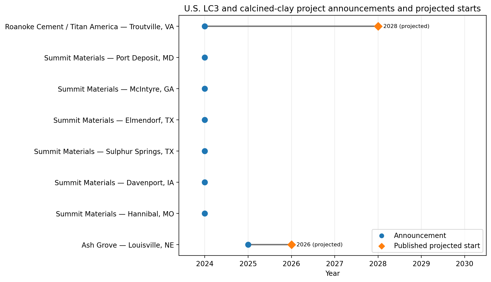

# LC3 and calcined-clay manufacturer projects — United States

The project register contains **eight source-linked facility records**: seven DOE-related locations and the Ash Grove Louisville facility. The Summit site lists are from two DOE documents and do not establish seven distinct funded facilities.

## Production timing

- **Roanoke Cement / Titan (Troutville, VA):** DOE's April 2024 regional briefing projected construction in 2025 and startup by **2028** (~4 years after announcement). The October 2024 DOE award covered Phase 1 engineering, not completed production.
- **Ash Grove (Louisville, NE):** In December 2025, Ash Grove reported an actual road demonstration using its manufactured calcined-clay blended cement, with full-scale production **planned for early 2026** and deliveries **planned for mid-2026** (~1 year). This product is not established in the source as an LC3 formulation.
- **Summit Materials:** DOE identified four proposed sites in its selection announcement and three locations in a later Phase 1 NEPA notice; neither source gives a verified commissioning year.

## Interpretation for the diffusion model

Manufacturer supply dates should be scenario-specific. The two published projections are not observed startup dates. The Ash Grove calcined-clay product should not automatically be counted as LC3 supply.

## References

- [DOE 2024 regional briefing (Roanoke 2028 projection)](https://www.energy.gov/sites/default/files/2024-04/IDP%20Mid-Atl%20App%20Region%20Community%20Briefing%20FINAL.pdf)
- [DOE Roanoke Phase 1 award, October 2024](https://www.energy.gov/cmei/oced/articles/award-wednesdays-october-16-2024)
- [DOE Summit project selection](https://www.energy.gov/cmei/oced/industrial-demonstrations-program-selected-and-awarded-projects-cement-and-concrete)
- [DOE Summit Phase 1 NEPA notice](https://www.energy.gov/nepa/articles/cx-033532-market-adoption-calcined-clay-low-carbon-concrete-infrastructure-project)
- [Ash Grove December 2025 announcement](https://www.ashgrove.com/news-insights/sustainable-6x9wp)
