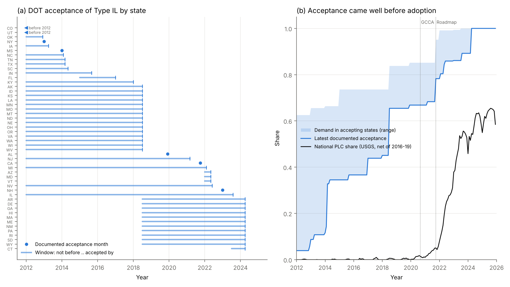
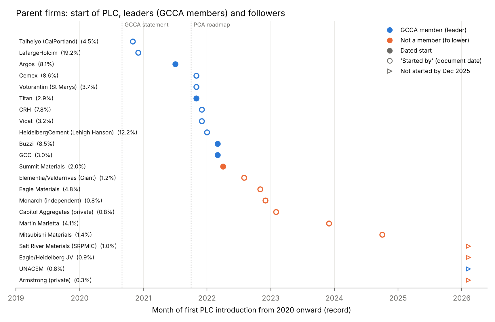
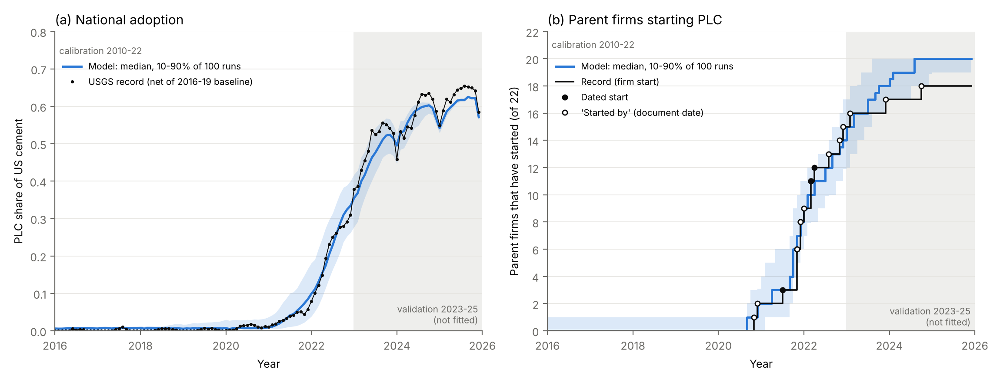
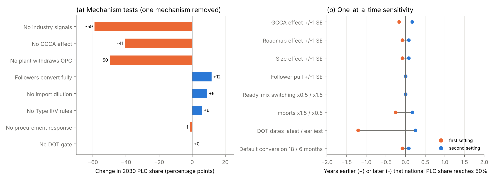

# Preliminary results: an evidence-based agent-based model of the US PLC transition

Companion documents: `model_document.md` (equations, parameters, assumptions) and `evidence_ledger.md` (evidence and references; item IDs in brackets).

---

## 1. Conceptual model

Portland-limestone cement (PLC, ASTM C595 Type IL) was standardised in 2012 [E2], was cheaper to make than ordinary portland cement (OPC) [E6], and was accepted by most state DOTs between 2013 and 2018 [G1, G2]. National adoption nevertheless stayed near zero until 2020 and then rose from about 5% to about 60% within three years [V1, V2]. The model is built around the explanation the evidence supports for this pattern.

**A coordination problem on the supply side.** Buyers had little reason to ask for a new cement and reported real switching friction [B1]. A producer that switched alone risked losing customers to competitors still offering OPC. No US firm started alone between the 2012 standard and 2020 [S7].

**Coordination devices broke the stall.** The GCCA 2050 Climate Ambition (September 2020) [S1] and the PCA Roadmap to Carbon Neutrality (October 2021) [S2] gave the large multinational producers, most of them GCCA members [S3], a common date. Their starts converge on late 2021 to early 2022 regardless of when each parent made its own climate commitment [S5]. Larger members moved first [S8].

**Fleet decisions and OPC withdrawal.** Parent firms decided for their whole fleet; plants followed within months [S11, P1]. The leaders did more than add a product: several withdrew Type I/II altogether [P1, P2], which left their customers with PLC-only supply. Adoption downstream followed supply rather than demand [P3].

**Followers and specialty markets.** Non-member firms added PLC beside OPC as their customers' markets moved [H1, H4]. In the Southwest, where the standard product is sulfate-resistant, low-alkali Type II/V, in-state plants did not offer Type IL (Arizona) or offered it beside Type II/V with little uptake (California) [W1-W5]. Imports, treated as OPC, keep part of the coastal markets on OPC [I1-I4].

**Permissive institutions.** DOT acceptance was a precondition for public work, not the trigger: early acceptances were followed by years without adoption [G2]. Procurement programs (Buy Clean, GSA, the Port Authority) came after most conversions and reinforced them [M1-M5].

The model represents this chain explicitly: industry signals and markets → firm start → plant introduction and OPC withdrawal → ready-mix purchases → state and national adoption, with DOT acceptance, imports and product classes as constraints.

## 2. Agents and decisions

| Agent | Decision | Drivers in the model | Evidence |
|---|---|---|---|
| Parent firm (22) | When to start offering PLC | Leaders: GCCA statement, PCA roadmap, firm size. Followers: PLC share in their customers' states | S1-S11, H1, H4 |
| Cement plant (100) | When to introduce PLC; whether and when to withdraw OPC; how fast to convert | Within-firm rollout lag; DOT gate; parent type (leaders withdraw, followers keep OPC); Type II/V product line keeps OPC; documented conversion speed | P1-P8, W1, W6 |
| Ready-mix plant (3,667) | What to buy from each linked plant | Transitional switching away from PLC-only supply while OPC is reachable; purchase probability from plants offering both (base, state norm, procurement); Type II/V exposure; cement-owned plants buy from their parent | B1-B4, M1-M5, W3, W4 |
| State DOT (50) | When to accept Type IL | Month within the documented acceptance window | G1, G2 |
| Imports | Share of each state's supply | 2022 import shares by customs district, treated as OPC | I1-I5 |

The firm decision is estimated from the firm record (2012-2022), not fitted to the adoption curve. The market layer (plants and ready-mix) is calibrated on 2010-2022 with firm starts replayed from the record. The two are then combined, with firm starts predicted, for validation on 2023-2025.

## 3. The two institutional records: DOT acceptance and firm starts

**Figure 1.** (a) Documented acceptance window of each state DOT (dot: dated acceptance; bar: window between the latest date before which acceptance is ruled out and the date by which it is documented). (b) Share of national demand located in states whose DOT had accepted Type IL (shaded: range from earliest to latest documented dates; line: latest), against the national PLC share. By mid-2018 about two-thirds of demand was in states with documented acceptance; adoption started in 2021.

**Figure 2.** Month in which each parent firm started its PLC transition (record: first PLC introduction from 2020 onward; niche lines that predate 2020 are not counted), with its share of US capacity. Blue: GCCA members; orange: non-members. Filled markers are dated starts; open markers are document dates (EPD issue, DOT list revision, data sheet), which bound the start from above. Eleven of the twelve members started between November 2020 and March 2022, around the two signals; non-members followed from 2022, and four firms (about 3% of capacity) had not started by December 2025.

## 4. Calibration and validation

### 4.1 Design

| Period | Months | Use |
|---|---|---|
| Firm-hazard estimation | 2012-01 to 2022-12 | Leaders/followers start hazard estimated from the firm-month record (2,733 firm-months, 15 starts) |
| Market calibration | 2010-01 to 2022-12 | Ready-mix and product-class parameters, firm starts replayed from the record |
| Validation (forecast) | 2023-01 to 2025-12 | Not used in estimation or calibration; USGS record through December 2025 |

The record was extended to December 2025 with the USGS Mineral Industry Surveys for December 2025 (`new_data/usgs_2025`), which gives a three-year forecast test while keeping 2022, the main take-off year, in the calibration window.

### 4.2 Method

**Firm layer.** Discrete-time logit hazard (Eq. 1 in `model_document.md`) estimated by maximum likelihood. The intercept is pinned so that 0.5 firms would be expected to start alone over 2012-2020 (0.15 and 1.5 tested), because the record has none. In every model run the four coefficients are drawn from their estimated covariance.

**Market layer.** Five free parameters are calibrated by Bayesian optimisation (Optuna TPE, 1,500 trials, 8 simulations per trial with common random numbers). The loss is the mean squared error of the national monthly share 2010-2022 plus a small-weight term (0.01) for annual state shares in 2020-2022, so that the national curve leads. The 20 trials within 10% of the best loss form the parameter sets used for validation.

### 4.3 Estimated and calibrated values

| Parameter | Meaning | Value (range across the 20 sets, or s.e.) |
|---|---|---|
| aG | Leaders' response to the GCCA statement | 3.86 (s.e. 0.74) |
| aP | Leaders' response to the PCA roadmap | 2.76 (0.74) |
| aS | Size effect for leaders after the GCCA statement | 1.03 (0.47) |
| aF | Followers' response to the PLC share in their customers' states | 23.7 (2.3) |
| a0 | Intercept, pinned to 0.5 solo starts in 2012-20 | -8.43 |
| sigR | Ready-mix switching away from PLC-only supply while OPC is reachable | 0.63 (0.61-0.66) |
| piD | PLC purchase probability added by procurement (from plants offering both) | 0.10 (0.09-0.13) |
| piL | State-norm effect on that probability | 0.001 (0.000-0.004) |
| pi0 | Base probability | 0.001 (0.000-0.003) |
| kiiv | Product-class constraint for buyers supplied by Type II/V-line plants | 1.00 (0.97-1.00) |
| H (fixed) | Months over which ready-mix switching fades | 18 |
| lC, sigma (fixed) | Leaders' withdrawal tolerance and expected loss per customer | 1, 1 |

Fitted values in plain terms:
- Before the GCCA statement, a GCCA member of average size had about a 0.02% monthly chance of starting. From the statement this rose to about 1%, and with the roadmap in force to about 14%.
- Ready-mix plants initially moved about 63% of PLC-only purchases back to OPC where they still could; this resistance fades over 18 months.
- Buyers supplied by Type II/V-line plants took essentially no PLC through 2022.
- The 2010-22 record cannot tell a procurement effect from none: calibrations within 10% of the best loss span piD = 0 to 0.25. Results that depend on piD are therefore shown as ranges.

### 4.4 Results

**Figure 3.** (a) National PLC share: model median and 10-90% band of 100 runs (20 parameter sets x 5 seeds) against the USGS record net of its 2016-19 baseline. (b) Parent firms that have started PLC: model against the record (filled markers dated starts, open markers document dates). Firm starts are predicted in both panels; the grey area is the validation window.

| Metric | Model (median of 100 runs) | Record |
|---|---|---|
| National share RMSE, calibration 2010-22 | 0.018 | |
| National share RMSE, validation 2023-25 | 0.034 | |
| National share 2025 | 0.60 | 0.62 |
| Parent firms started by Dec 2025 | 20 | 18 |
| Firm start timing error (median over firms) | 3 months | |
| Firms that start in the model but not in the record (expected number) | 2.9 (2.0% of capacity) | |
| State share RMSE (demand-weighted), 2022 / 2025 | 0.18 / 0.14 | |

Reading:
- The model reproduces the 2021-22 take-off and its speed, and forecasts 2023-25 within about 3 to 4 points of the record. It tracks the 2024 and 2025 dips, which come from the demand input.
- Firm starts follow the record closely through early 2023. From mid-2023 the model adds firms faster: three small non-members start in most runs (Armstrong, the Texas Lehigh joint venture, UNACEM). Every record step after 2022 is a document date, so the record is late-biased in this period.
- **Remaining state-level misses (2025, model vs record):**

  | State | Model | Record |
  |---|---|---|
  | California | 0.00 | 0.10 |
  | Nevada | 0.01 | 0.12 |
  | New Mexico | 0.88 | 0.44 |
  | Pennsylvania | 0.72 | 0.39 |
  | New York | 0.66 | 0.51 |
  | Texas | 0.34 | 0.47 |

  The Pennsylvania and New York gap matches evidence that some leader plants there still lacked Type IL years after their parent started [P6].

## 5. Mechanisms and sensitivity

**Figure 4.** (a) Change in the 2030 national share when one mechanism is removed (paired runs, same seeds). (b) Change in the year the national share first reaches 50% under one-at-a-time parameter changes.

Selected mechanism tests (baseline: 50% reached in 2023.7; 2030 share 0.60):

| Mechanism removed | 50% reached | 2030 share | Reading |
|---|---|---|---|
| Industry signals (GCCA and roadmap) | never | 0.01 | Followers respond to their customers' markets, which do not move without the leaders; the record has no solo starts before 2020, so the pinned intercept keeps solo starts rare |
| GCCA statement only | 2032.4 (80% of runs never) | 0.19 | The GCCA statement carries most of the leaders' timing |
| PCA roadmap only | 2025.7 | 0.57 | The roadmap accelerates the leaders by about two years |
| Plant OPC withdrawal | never | 0.10 | Withdrawal by leaders is the main adoption channel: offering PLC beside OPC moves few buyers |
| Followers keeping OPC (they convert fully instead) | 2023.4 | 0.72 | Followers' choice to keep OPC costs 12 points |
| Import dilution | 2023.4 | 0.69 | Imports hold about 9 points of the market on OPC |
| Type II/V rules (plants and buyers) | 2023.4 | 0.66 | The Southwest constraint costs about 6 points; plant and buyer rules each about 2 points alone |
| DOT gate | 2023.3 | 0.60 | Removing the gate brings 50% four months earlier; it does not change the level |

One-at-a-time sensitivity: no single change moves the 50% date by more than 1.2 years. The largest effects are:
- DOT acceptance at the latest documented dates: 1.2 years later.
- Removing the size effect: 0.3 years later.
- Imports ×0.5 or ×1.5: ±4.6 points on the 2030 share.
- piD from 0 to 0.5: 2030 share from 0.59 to 0.65.

The intercept variants (0.15 and 1.5 expected solo starts), ±1 standard error on each firm coefficient, ready-mix switching ×0.5 or ×1.5, and the default conversion period (6 or 18 months) each move the 50% date by 0.3 years or less.

## 6. Interventions: ideas and implementation

The intervention analysis will use paired runs (same seeds as the baseline) to 2035. Each idea below maps to an option already in `model.simulate` (examples in `code/scenarios.py`, set `interventions`).

| Idea | Question it answers | Implementation |
|---|---|---|
| Earlier coordination device (an industry roadmap or joint launch, as in Canada in 2011 [C1]) | Would earlier collective commitments have moved the transition years earlier? | `signal_shift` (months earlier for both signals) or `shift1`/`shift2` separately |
| Coordination device combined with early DOT acceptance | Are the two complements? | `signal_shift` with `dot_all` (all DOTs accept by a date) |
| First movers by policy or agreement | What if the three largest firms commit early? | `force_conv` for chosen firms and month |
| Broader club membership | Does bringing non-members into the club accelerate followers? | `members_extra` |
| Procurement strength and timing | How much can public procurement add, and when? | `piD` (level), `proc_date` (start), `proc_end` (end) |
| Imports meeting the specification | How large is the import channel? | `_imp_spec` (month from which imports carry PLC) |
| Support for followers to convert fully | What does follower OPC retention cost? | `follower_keep_opc = False` |
| Qualification of sulfate-resistant PLC in Type II/V markets | How much of the Southwest gap is product class? | `iiv_release`, `kiiv_release` (plants and buyers separately) |
| Incumbent sunset in public work | What does a phase-down date add once supply exists? | `sunset` |
| Information or demonstration programs for buyers | Can buyer-side measures move uptake where both products are offered? | `pi_boost` (increase and start month) |

## 7. Adapting the model to LC3

LC3 (limestone calcined clay cement) differs from PLC in ways the evidence documents [L1-L5]. The decision structure carries over; the following changes apply.

1. **No incumbent withdrawal at first.** LC3 is not a one-for-one replacement in every use and requires new calcining capacity, so plants offer it beside OPC/PLC. Set `all_keep_opc = True`. Adoption then runs through buyer choice (Eq. 9), which becomes the central channel.
2. **Capital barrier in the firm decision.** Add a term K to the start hazard for building a calciner and securing clay, with one calciner decision per plant at a time and a build time of 24-48 months [L2, L3]. Fit K to the observed LC3 decisions: Titan Troutville, Ash Grove Louisville and the Summit projects, and the terminated Lebec award.
3. **Buyer choice as a scenario parameter.** The PLC record does not identify buyer choice where both products are offered (section 4.3), so pi0, piL and piD are set by scenario. The LC3 conclusions are reported across that range.
4. **Product classes.** General-use Type IT first; specialty classes (sulfate exposure, early strength) qualify later, using the same mechanism as Type II/V for PLC (`kiiv`, `kiiv_release`) [W5, L1].
5. **Endogenous DOT acceptance.** For LC3, acceptance is part of the question. A state accepts within a lag after a supplier serving it commits, seeded with the documented early acceptances (NDOT 2025; FL, VA and NC for Titan's Type IT) [L3, L5].
6. **Interventions specific to LC3:**
   - capital support (a share of K);
   - advance purchase commitments (a fixed increase in buyer choice for a set period);
   - an incumbent sunset in public work;
   - a coordination device, which matters less where withdrawal is not available.

The PLC calibration provides the firm-signal, rollout, conversion, ready-mix switching and import components. The LC3 regime test (`code/scenarios.py`, set `lc3`) runs the PLC model with `all_keep_opc = True`, as a first check of how the levers change once withdrawal is unavailable.
